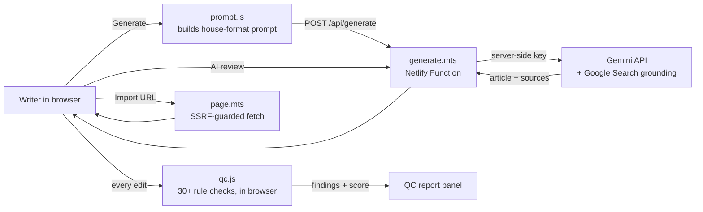

# Architecture

## Design decisions

**The API key never reaches the browser.** The browser calls `/api/generate`, a Netlify Function that reads `GEMINI_API_KEY` from environment variables. Anyone viewing the page source sees no key. An optional `ACCESS_CODE` stops strangers from spending the free quota.

**QC runs locally.** The quality checker is pure JavaScript with no network calls, so it is instant, free, works offline, and checks text the writer pastes without sending it anywhere. The same file runs in Node for tests.

**The prompt is built in the browser.** Writers can see exactly what is sent ("Copy prompt") and reuse it in any chat model — transparency and a manual fallback if the API is rate-limited.

**No framework, no build step.** Three small scripts and one stylesheet keep the project easy to read, fast to load and free to host.

**Structured output via front matter.** The model returns YAML-style front matter (title, meta, keyword, slug). The app parses it into editable SEO fields, which the QC engine then checks — closing the loop between writing and auditing.

## Functions

| Endpoint | Method | Purpose |
|---|---|---|
| `/api/generate` | POST | Proxies a prompt to Gemini (model allow-list, size cap, 55 s timeout); returns text, grounding sources and search queries |
| `/api/page?url=` | GET | Fetches a public page for QC import; blocks private/internal hosts, 2 MB cap, 12 s timeout |
| `/api/status` | GET | Reports whether a key and access code are configured (booleans only) |

## Free-tier limits

- Gemini free tier has per-minute and per-day request limits; the app surfaces a clear message on HTTP 429 and lets a user supply a personal key.
- Netlify free tier covers functions and bandwidth comfortably for a personal or small-team tool.
